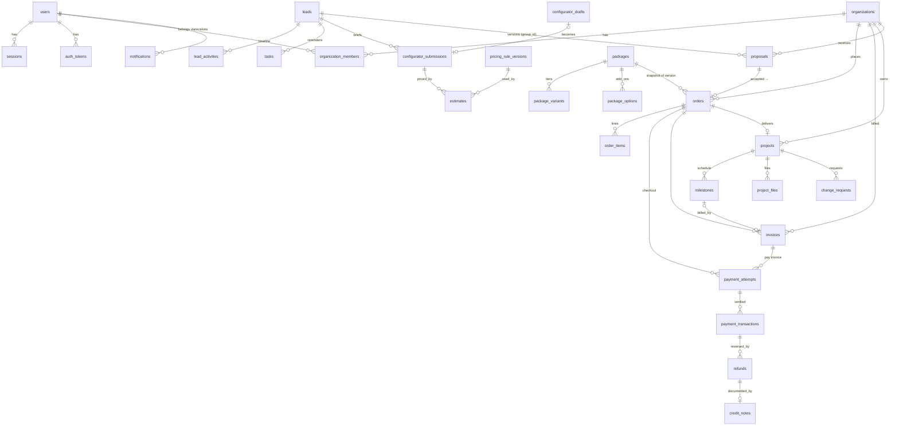

# Data model

Source of truth: `lib/db/src/schema/*.ts` (Drizzle). Migrations: `lib/db/migrations` (`0000_initial.sql` generated; `0001_integrity_guards.sql` hand-written).

## Entity relationships

Ownership: every client-visible record carries `organization_id`. Individuals get a personal organisation, so authorisation is always "is the user a member of this organisation?" (`assertOrgAccess`, which returns 404 — not 403 — to avoid confirming existence).

## Tables

| Group | Table | Notes |
| --- | --- | --- |
| Identity | `users` | unique `email_normalized`; `role` ∈ client/staff/finance/admin/owner; `password_hash` (scrypt) nullable for passwordless accounts; encrypted `mfa_secret`; lockout counters; notification prefs |
| | `sessions` | `token_hash` (SHA-256 of cookie value), expiry, revocation, `mfa_verified` |
| | `auth_tokens` | single-use, hashed, expiring tokens: verify_email, password_reset, magic_link, invite |
| | `organizations`, `organization_members` | billing details; membership role |
| Content | `portfolio_projects` | case-study fields, status label (live/in_development/concept/internal_tool), publication status, display order, testimonial, optional Markdown body |
| | `service_categories`, `faqs`, `testimonials` | CMS |
| Catalogue | `packages` | pricing mode (fixed/starting_from/quote_only), `price_minor`, deposit rule (JSON), status, capacity, `version` (bumped on any commercial change) |
| | `package_variants`, `package_options` | tiers; add-ons with pricing type and compatibility rules (requires/excludes/variants) |
| CRM | `leads` | normalised email (indexed, not unique — dedupe is logic), source, status, owner, follow-up, `possible_duplicate_of_id`, consent, attribution |
| | `lead_activities`, `tasks` | timeline; reminders (also used for projects) |
| Configurator | `configurator_drafts` | hashed resume token, partial answers, 30-day expiry |
| | `configurator_submissions` | immutable answers JSON (`brief_version`), unique `idempotency_key` |
| | `pricing_rule_versions` | rules JSON, status draft/active/retired (**partial unique index: one active**), `row_version` for optimistic locking, approval fields, `is_demo` |
| | `estimates` | snapshot of the full engine output + rule version id; low/high/total/deposit columns for querying |
| Commerce | `proposals` | `group_id` + `version` (unique pair), totals, tax snapshot, milestones JSON, `content_hash`, acceptance metadata, `row_version` |
| | `orders`, `order_items` | immutable `snapshot` JSON, unique `idempotency_key`, terms version accepted |
| | `invoices` | unique gapless `number`, lines, tax/billing/issuer snapshots, paid/refunded amounts |
| | `payment_attempts` | unique `reference` and `idempotency_key`; provider checkout id; EFT proof file |
| | `payment_transactions` | **unique (provider, provider_transaction_id)**; verification method; refunded amount |
| | `webhook_events` | **unique (provider, event_id)**; signature validity; processing status, result, retry count; redacted payload |
| | `refunds`, `credit_notes` | reason, link to original transaction, idempotency key |
| | `number_sequences` | row-locked counters for document numbers |
| Delivery | `projects` | status, manager, contract value, deposit requirement/paid timestamp/exception (reason + approver) |
| | `milestones` | status, amount, billable, linked invoice, visibility (client/internal) |
| | `project_files` | private object key, sniffed MIME, size, SHA-256, kind, visibility, soft delete |
| | `change_requests` | type (defect/change/support/question), impact estimate, client decision |
| | `messages` | threads for project/proposal/change_request; `internal` notes never returned to clients |
| System | `notifications` | outbox + in-app; unique `dedupe_key`; attempts/status |
| | `settings` | key → JSON (business, commerce, tax, security, configurator) validated by Zod on read/write |
| | `audit_events` | append-only (trigger rejects UPDATE/DELETE) |
| | `analytics_events` | first-party funnel events |

## Integrity guards (`0001_integrity_guards.sql`)

- `audit_events` append-only trigger.
- One active pricing version (partial unique index).
- Non-negative money / refund ≤ paid check constraints on orders, invoices, attempts, transactions, refunds, packages.
- `invoices`, `orders`, `payment_transactions`, `refunds` cannot be deleted (trigger) — void, cancel or credit instead.

## Changing the schema

1. Edit `lib/db/src/schema/*.ts`.
2. `pnpm db:generate` (review the generated SQL; add hand-written SQL migrations with `drizzle-kit generate --custom` for triggers/constraints).
3. `pnpm db:migrate` locally and run the tests. Never edit production schema by hand.
